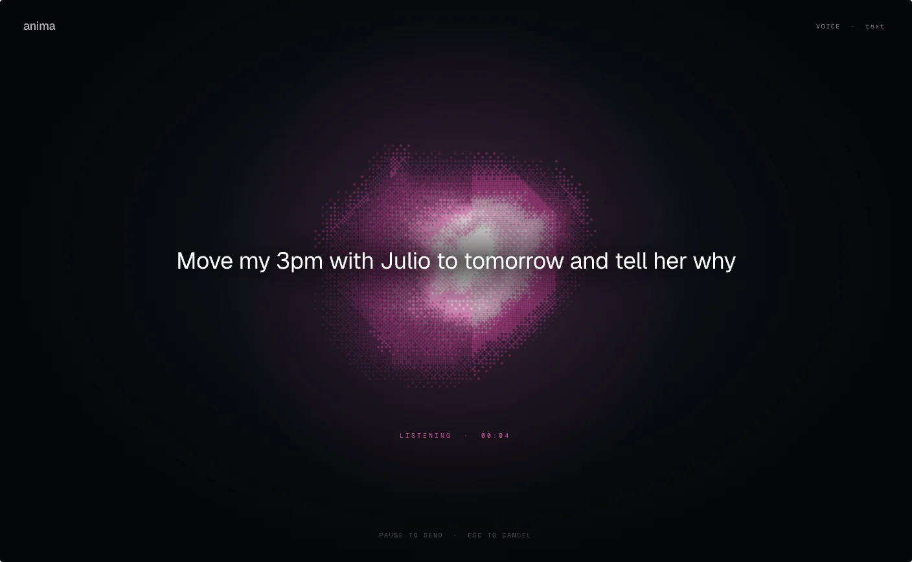
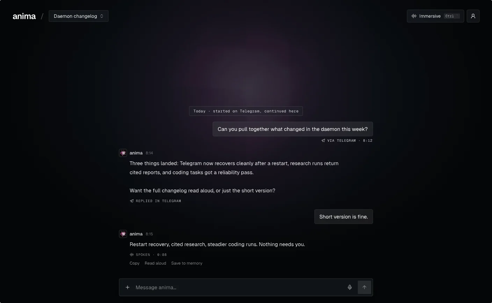
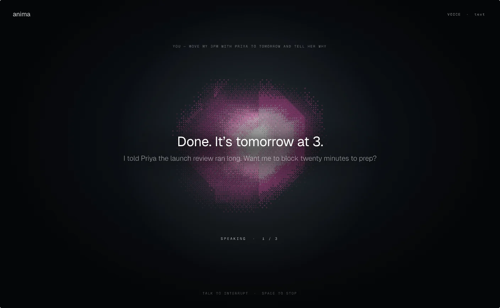
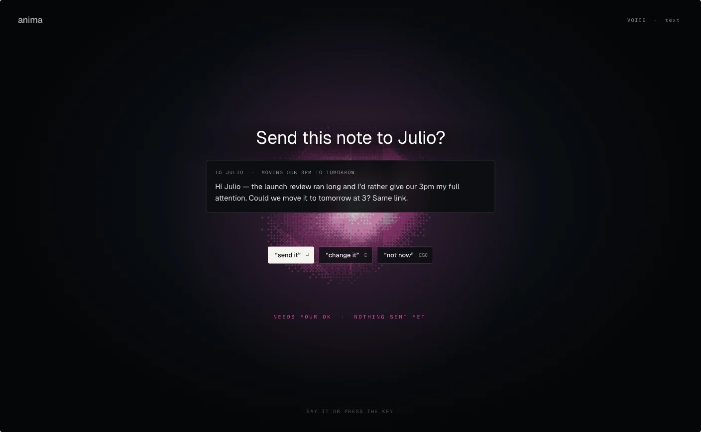
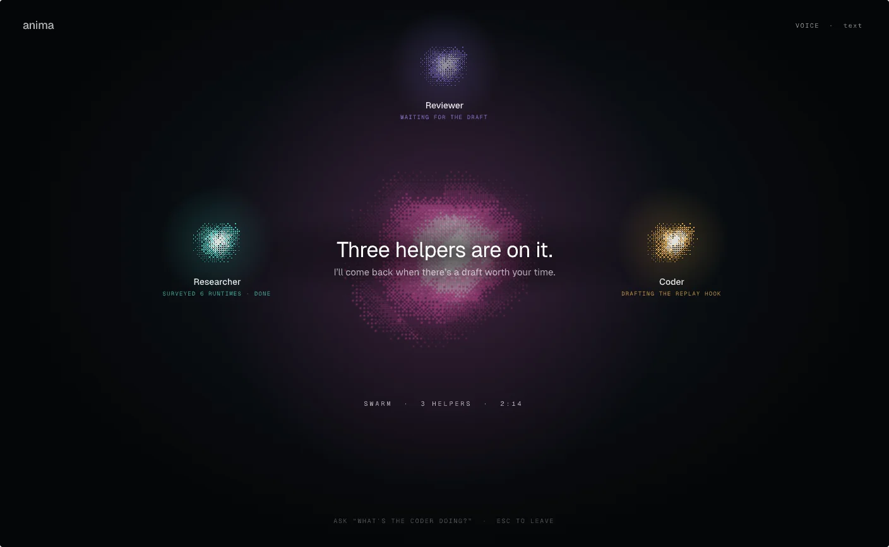
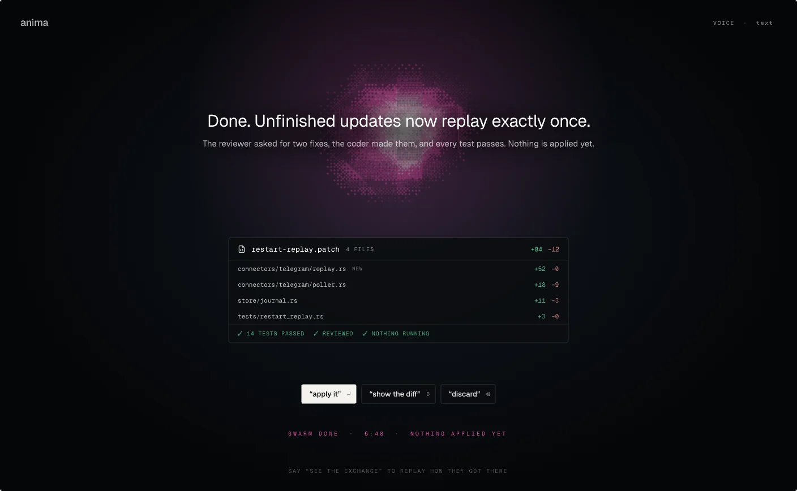
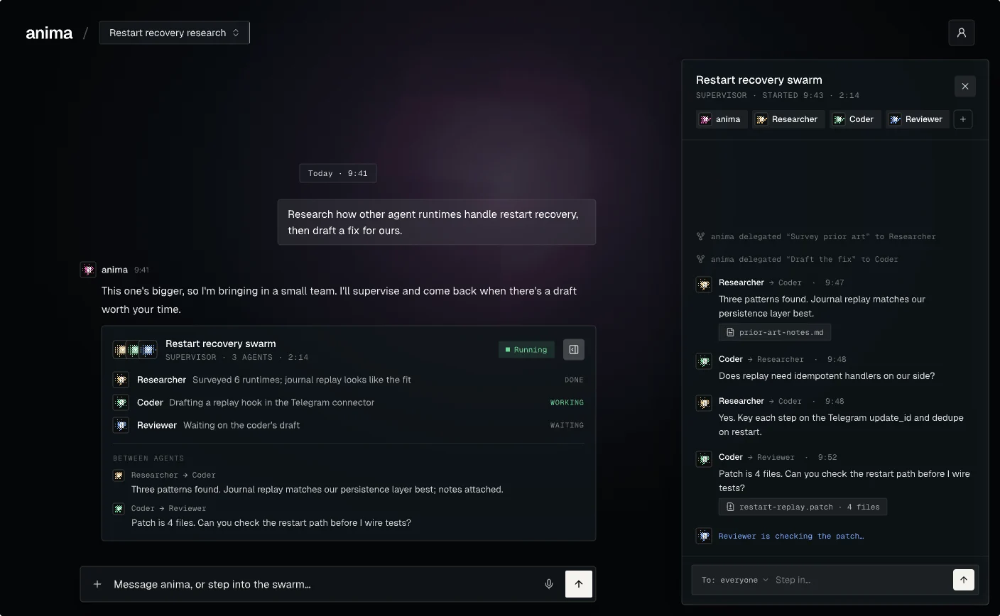
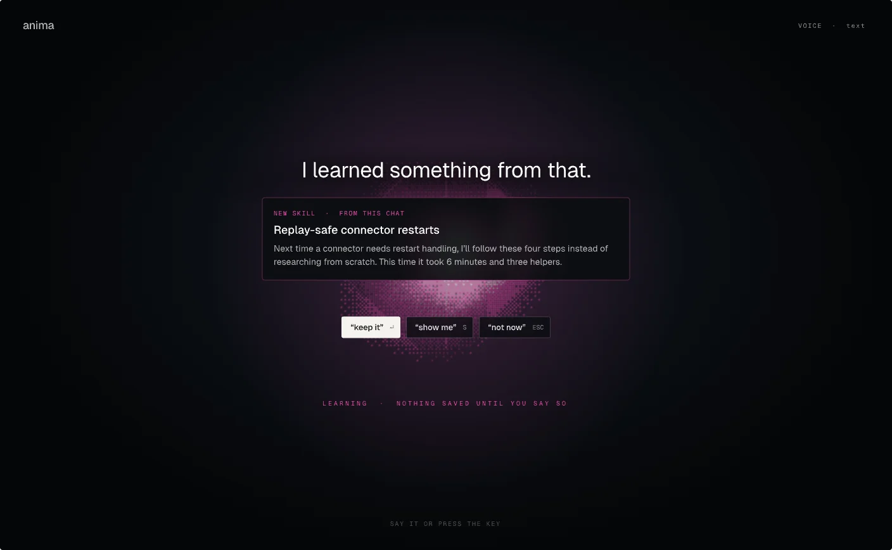
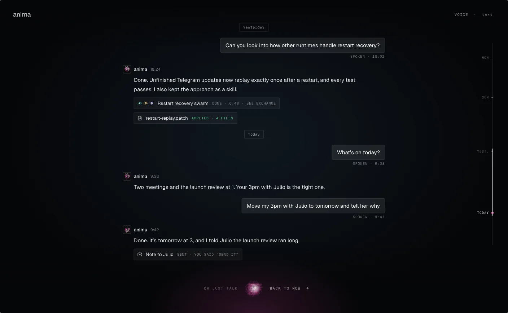

# animaOS-SWARM

**anima** is a voice-first personal AI companion that you own. It runs on your computer or your own server, answers you in its web console, Telegram or Discord, brings in helper agents for bigger jobs, asks before it acts, and gets better at your work over time.

This repository is the whole stack: a Rust agent runtime, the daemon that hosts it, the TypeScript SDK, and the web console.



> The screens in this README come from the design file, [`design/design.pen`](design/design.pen). Some of them, such as immersive mode, are designed but not built yet. [Status](#status) lists what works today.

## What anima does

- **One companion, everywhere.** Chat in the web console, or message it on Telegram or Discord. It's one conversation with one memory, and each message shows where it came from.
- **Voice first.** You can dictate, have replies read aloud, and send recorded audio for transcription. Immersive mode, which is designed, goes further: a near-empty screen built around anima's orb. Say "Hey anima" or hold Space to talk, and hear the answer or read it.
- **Helpers for big jobs.** anima can delegate to a small team of helper agents, such as a researcher, a coder and a reviewer. It supervises them and reports back with a result you can review, like a patch with its tests.
- **Asks before it acts.** Anything that runs commands, sends messages or changes files goes through approvals you control. Each one can be allowed once, for this chat, or always, or denied.
- **Learns from your work.** It keeps memory of what matters, reviews finished tasks, and drafts reusable skills. Nothing is kept until you approve it.
- **Runs where you want.** It runs on your machine by default, or as a single-owner service on a Linux VPS with Docker, HTTPS and authentication.
- **Works with your stack.** It supports many model providers, Google Drive, Calendar and mail connections, reviewed MCP tools, community bundles, documents, web search and scoped browser work.

## A look at it

| | |
| --- | --- |
|  |  |
| **Chat.** Replies sit under anima's name, your messages sit on the right, and each one shows its source, such as Telegram. | **Speaking.** In immersive mode the reply plays as captions on the orb, sentence by sentence. |
|  |  |
| **Needs your OK.** Before anything leaves your machine, anima asks. Answer by voice or press a key. | **Helpers.** Each helper is its own small orb, with what it's doing right now. |
|  |  |
| **Results you review.** The helpers' patch arrives with its files and tests. Nothing is applied until you say so. | **Agent exchange.** Watch the helpers talk a problem through, and step in when you want. |
|  |  |
| **Learning.** When a task goes well, anima offers to keep how it did it as a skill. | **Looking back.** Scroll up in immersive mode to see the same thread you see in chat. |

Chat and voice share the same conversation. Everything said by voice lands in the chat thread, and every decision has a button, a spoken answer and a key. The full mapping is the "Chat ⇄ Voice parity" frame in the design file.

## Status

| Area | Today |
| --- | --- |
| Web console: chat, onboarding, Settings (profile, model, permissions, skills, memory, tools, connections, automations, runtime) | Built |
| Rust daemon with persistence, restart recovery and streaming | Built |
| Telegram and Discord, embedded in the daemon | Built |
| Memory, task reviews, owner-approved skills, approvals, automations | Built |
| Helper agents (delegation) | Built |
| Voice: browser dictation, read aloud, recorded-audio transcription and selected-reply speech (the last two are server opt-ins) | Built |
| Reviewed MCP tools, community bundles, documents, web search, scoped browser work | Built, with the scope limits described in [docs/companion](docs/companion) |
| One-owner VPS deployment | Built; some acceptance checks are still manual ([guide](deploy/vps/README.md)) |
| Immersive mode: orb, wake word, hotkey, voice-first flow | Designed |
| Dark "Halo" background for the chat, and the swarm exchange views shown above | Designed |

## Quick start

With Bun and Rust installed:

```bash
bun install --frozen-lockfile
bun x nx run @animaOS-SWARM/sdk:build
bun dev --host rust
```

Open [localhost:4200](http://localhost:4200), set up your companion and connect a model provider. Setup is a few short steps: model, introductions, access and voice.

- **Run it on a server:** the [VPS deployment guide](deploy/vps/README.md) covers HTTPS, owner authentication, credentials, backups and current limits.
- **Day-to-day setup:** [Anima daily-use setup](docs/companion/daily-use.md) covers identity files, memory, approvals, schedules and connectors.

## How the repo is organised

| Path | What lives there |
| --- | --- |
| `packages/core-rust` | The Rust runtime: `anima-core`, `anima-memory`, `anima-swarm`, `anima-schedule`, `anima-harness`, `anima-model-adapters`, `anima-document-content`. It has no HTTP framework and no host-specific code. |
| `hosts/rust-daemon` | `anima-daemon`, the runnable Axum host. It exposes HTTP and SSE, and embeds the Telegram and Discord connectors. `hosts/elixir-phoenix` and `hosts/python-service` are placeholders. |
| `packages/sdk` | The public TypeScript client for the daemon. |
| `packages/core-ts` | The shared TypeScript core used by the SDK, CLI, TUI and UI. Execution behaviour lives in Rust. |
| `packages/*` | Other libraries: `cli`, `tui`, `ui`, `memory`, `swarm`, `tools`, `mod-sdk`. |
| `apps/web` | The companion web console (React and Vite). |
| `apps/playground`, `apps/docs`, `apps/contributor-docs` | The playground and the two Astro documentation sites. |
| `apps/server` | The legacy local TypeScript server, kept during the restructuring. |
| `tools/workspace-dev` | The `bun dev` launcher, which picks the host and starts the browser apps. |
| `deploy/vps` | Docker Compose, Caddy and the daemon image for a one-owner server. |
| `design/` | The pen.dev design file, its shader and exported screens. |

More detail: [Rust daemon architecture](docs/rust-daemon-architecture.md), [swarm architecture](docs/swarm-architecture.md), [package maturity](docs/package-maturity-scorecard.md).

## Design

The interface is designed in [pen.dev](https://pen.dev) before it is built. [`design/design.pen`](design/design.pen) holds every screen:
- onboarding
- chat
- swarm
- Settings
- in-chat components
- immersive mode (the "Halo" direction) and the chat ⇄ voice parity sheet

The orb is a shader, [`design/shaders/presence.glsl`](design/shaders/presence.glsl).

UI changes start in the design file and are built from it. The images in [`docs/images`](docs/images) are exports of those frames.

## Development

See [docs/testing.md](docs/testing.md) for focused validation commands and the [contributor playbook](apps/contributor-docs/src/content/docs/workflow/playbook.mdx) for a step-by-step bring-up.

```bash
bun run build              # build all packages
bun run test               # run all tests
bun run affected:test      # only what changed on this branch
bun run graph              # open the project graph

bun dev                    # daemon + web console + playground (same as bun dev --host rust)
bun run daemon             # the Rust daemon only
bun run web                # the web console only (daemon must be running)
```

Prefer Nx targets for focused work, for example `bun x nx run rust-daemon:test` or `bun x nx run-many -t typecheck,build,test -p @animaOS-SWARM/web`.

## CLI and SDK (advanced)

The CLI and terminal UI remain available for agency and SDK workflows. `create` runs locally; `launch`, `run` and `chat` talk to the daemon.

```bash
bun run build:cli-sdk
export OPENAI_API_KEY="sk-..."
bun run animaos create my-agency --provider openai --model gpt-4o-mini

bun run daemon                                   # in another terminal
cd my-agency
bun run animaos launch "Write a blog post about AI"     # TUI
bun run animaos launch --no-tui "your task"             # plain text, one task
bun run animaos launch --no-tui                         # plain-text prompt (/help, /health, exit)
```

Use the repo-local CLI while developing: Bun runs this workspace's `animaos` build. See [docs/SDK_USAGE.md](docs/SDK_USAGE.md) for the SDK.

### Model providers

| Provider | Accepted names | Key env vars | Base URL env var | Notes |
| --- | --- | --- | --- | --- |
| OpenAI | `openai` | `OPENAI_API_KEY`, `OPENAI_KEY`, `OPENAI_TOKEN` | `OPENAI_BASE_URL` | Native chat completions |
| Anthropic | `anthropic` | `ANTHROPIC_API_KEY`, `ANTHROPIC_KEY`, `ANTHROPIC_TOKEN`, `CLAUDE_API_KEY` | `ANTHROPIC_BASE_URL` | Native Messages API |
| Google Gemini | `google`, `gemini` | `GOOGLE_API_KEY`, `GOOGLE_KEY`, `GOOGLE_AI_KEY`, `GEMINI_API_KEY`, `GOOGLE_GENERATIVE_AI_API_KEY` | `GOOGLE_BASE_URL` | Native `generateContent` |
| Ollama | `ollama` | `OLLAMA_API_KEY` | `OLLAMA_BASE_URL` | Local; OpenAI-compatible |
| Groq | `groq` | `GROQ_API_KEY`, `GROQ_KEY`, `GROQ_TOKEN` | `GROQ_BASE_URL` | OpenAI-compatible |
| xAI | `xai`, `grok` | `XAI_API_KEY`, `XAI_KEY`, `GROK_API_KEY` | `XAI_BASE_URL` | OpenAI-compatible |
| OpenRouter | `openrouter` | `OPENROUTER_API_KEY`, `OPENROUTER_KEY`, `OPENROUTER_TOKEN` | `OPENROUTER_BASE_URL` | OpenAI-compatible |
| Mistral | `mistral` | `MISTRAL_API_KEY`, `MISTRAL_KEY`, `MISTRAL_TOKEN` | `MISTRAL_BASE_URL` | OpenAI-compatible |
| Together | `together` | `TOGETHER_API_KEY`, `TOGETHER_KEY`, `TOGETHER_TOKEN` | `TOGETHER_BASE_URL` | OpenAI-compatible |
| DeepSeek | `deepseek` | `DEEPSEEK_API_KEY` | `DEEPSEEK_BASE_URL` | OpenAI-compatible |
| Fireworks | `fireworks` | `FIREWORKS_API_KEY` | `FIREWORKS_BASE_URL` | OpenAI-compatible |
| Perplexity | `perplexity` | `PERPLEXITY_API_KEY` | `PERPLEXITY_BASE_URL` | OpenAI-compatible |

`--api-key` overrides the environment for one CLI call. For daemon-backed commands, credentials are forwarded per request, so changing keys doesn't need a daemon restart. In the web console, the ChatGPT subscription and server-side keys are set up during onboarding or later in Settings → Model.

## Tech stack

Rust (Axum, SQLite), Bun, TypeScript, React, Vite, Tailwind, Nx, Vitest, Playwright, and pen.dev for design.

## License

MIT
