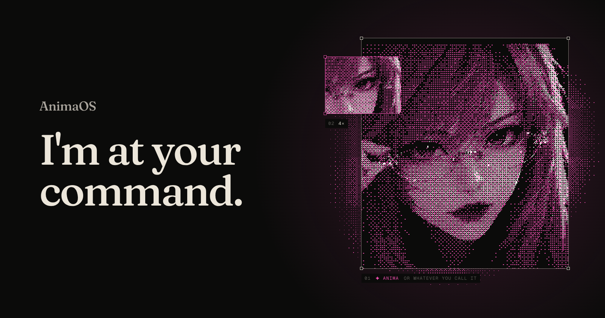

# AnimaOS

**An agentic operating system**

AnimaOS brings persistent AI agents, memory, tools, and automations into one personal workspace. It runs on your computer or your own server, on top of your existing operating system. You choose the models, connect the tools, and decide how independently your agents can work.

Talk to anima in the web console or through a connected chat app. Give it work to do, let it bring in helpers, and follow its plans, actions, and results in the same place. Its context carries across conversations through saved memory and reusable skills.

This repository contains the system: a reusable Rust agent runtime, the daemon that hosts it, a TypeScript SDK, CLI and terminal UI, and the web console.

## What you can do

- **Keep agents for different parts of your life.** Each agent has its own main conversation and memory. Switch between them in the console and return to their saved context.
- **Work with files, code, and documents.** Agents can use workspace tools, run commands and background processes, research the web, and use configured services such as Google Drive, Calendar, and mail. Reviewed MCP tools and community bundles extend what they can use.
- **Delegate bigger jobs.** An agent can bring in helpers for research, coding, or review, supervise their work, and bring the results back to your conversation.
- **Build useful memory and skills.** Save preferences and facts, recall earlier work, and turn successful tasks into reusable skills. Review and manage what your agents keep.
- **Schedule recurring work.** Automations and background tasks run in the daemon while the console is closed. The daemon must stay running for that work to continue.
- **Use chat and voice.** Type, dictate, or listen to replies. Paired private Telegram messages join the main conversation; Telegram groups and Discord channels have separate threads. Recorded-audio transcription and selected-reply speech are available as server opt-ins.
- **See what happened.** Plans, helper progress, action records, a Needs-you inbox, and weekly reports make work, approvals, failures, and recorded usage visible.

## Choose how independently agents work

Set autonomy per agent in Settings:

- **Free:** carries out ordinary work and reports what it did, with additional checks for sensitive actions.
- **Strict:** asks before changes, command execution, or delegation.
- **Custom:** uses the individual approval rules you configure.

Blocked commands and protected-action checks still apply. Plans and approvals follow the selected policy; granting tool access does not make every action unconditional.

## Current scope

The working stack is the Rust daemon and web console, with persistent agents, memory, tools, delegation, schedules, and embedded Telegram and Discord connectors. Local models are supported through Ollama; hosted providers are also available.

AnimaOS is under active development. Tool and connector capabilities have specific setup and scope limits, documented in the [daily-use guide](docs/companion/daily-use.md). Browser work is currently scoped; see [browser support and limits](docs/companion/browser-work.md). Interrupted work may require review after a daemon restart. Full mission resume, universal undo, and wake-word voice are not complete.

The [VPS deployment package](deploy/vps/README.md) targets one trusted owner. Public deployment, real account integrations, and microphone behavior still have manual acceptance checks; see the guide for the current verification boundary.

## Quick start

Install Bun and the Rust toolchain, then run from the repository root:

```bash
bun install --frozen-lockfile
bun x nx run @animaOS-SWARM/sdk:build
bun dev --host rust
```

Open [localhost:4200](http://localhost:4200), create your companion, select its workspace, and connect a model provider. Onboarding covers the model, introductions, access, and voice.

The launcher selects the Rust host and starts the web console, playground, and documentation sites. The console connects to the daemon at `127.0.0.1:8080`. Restored Telegram and Discord connectors run inside the daemon.

- **Run it on a server:** the [VPS deployment guide](deploy/vps/README.md) covers HTTPS, owner authentication, credentials, backups and current limits.
- **Day-to-day setup:** [Anima daily-use setup](docs/companion/daily-use.md) covers identity files, memory, approvals, schedules and connectors.

## Architecture

Reusable engine code lives in `packages/`; runnable backend processes live in `hosts/`; user-facing surfaces live in `apps/`. Host selection stays in `tools/workspace-dev`.

| Path | What lives there |
| --- | --- |
| `packages/core-rust` | The reusable Rust runtime: `anima-core`, `anima-memory`, `anima-swarm`, `anima-schedule`, `anima-harness`, model adapters, and document support. The core stays independent of backend hosts. |
| `hosts/rust-daemon` | `anima-daemon`, the runnable Axum host. It exposes HTTP and SSE, and embeds the Telegram and Discord connectors. |
| `packages/sdk` | The public TypeScript client for the daemon. It owns the shared TypeScript types. |
| `packages/cli`, `packages/tui`, `packages/ui` | The `animaos` command line, its terminal UI, and shared web components. All are thin clients of the daemon. |
| `apps/web` | The companion web console (React and Vite). |
| `apps/playground`, `apps/docs`, `apps/contributor-docs` | The playground and the two Astro documentation sites. |
| `tools/workspace-dev` | The `bun dev` launcher, which picks the host and starts the browser apps. |
| `deploy/vps` | Docker Compose, Caddy and the daemon image for a one-owner server. |
| `design/` | The pen.dev design file and the orb shader. |

More detail: [Rust daemon architecture](docs/rust-daemon-architecture.md), [swarm architecture](docs/swarm-architecture.md).

Workspace and npm package names still use `animaOS-SWARM` / `@animaOS-SWARM`; use those names in the commands below.

## Design

The interface is designed in [pen.dev](https://pen.dev) before it is built. [`design/design.pen`](design/design.pen) holds every screen:

- the end-to-end journey and onboarding
- the main chat, its states (working, offline, errors, plans, receipts) and the agent switcher
- the Needs-you inbox and the weekly report
- chat moments, helpers, and every Settings page
- the components sheet, mascot explorations and the landing page

The orb is a shader, [`design/shaders/presence.glsl`](design/shaders/presence.glsl).

UI changes start in the design file and are built from it.

## Development

See [docs/testing.md](docs/testing.md) for focused validation commands and the [contributor playbook](apps/contributor-docs/src/content/docs/workflow/playbook.mdx) for a step-by-step bring-up.

```bash
bun run build              # build all packages
bun run test               # run all tests
bun run affected:test      # only what changed on this branch
bun run graph              # open the project graph

bun dev                    # daemon + web console + playground (same as bun dev --host rust)
bun run daemon             # the Rust daemon only
bun run web                # the web console only (daemon must be running)
```

Prefer Nx targets for focused work, for example `bun x nx run rust-daemon:test` or `bun x nx run-many -t typecheck,build,test -p @animaOS-SWARM/web`.

## CLI and SDK

The CLI and terminal UI remain available for agency and SDK workflows. `create` runs locally; `launch`, `run` and `chat` talk to the daemon.

```bash
bun run build:cli-sdk
export OPENAI_API_KEY="sk-..."
bun run animaos create my-agency --provider openai --model gpt-4o-mini

bun run daemon                                   # in another terminal
cd my-agency
bun run animaos launch "Write a blog post about AI" # TUI
bun run animaos launch --no-tui "your task"         # plain text, one task
bun run animaos launch --no-tui                     # plain-text prompt (/help, /health, exit)
```

Use the repo-local CLI while developing: Bun runs this workspace's `animaos` build. See [docs/SDK_USAGE.md](docs/SDK_USAGE.md) for the SDK.

For task progress, background helpers, local Python, and selected-file recovery, see the [Rust autonomous runtime guide](hosts/rust-daemon/README.md#autonomous-runtime).

### Model providers

| Provider | Accepted names | Key env vars | Base URL env var | Notes |
| --- | --- | --- | --- | --- |
| OpenAI | `openai` | `OPENAI_API_KEY`, `OPENAI_KEY`, `OPENAI_TOKEN` | `OPENAI_BASE_URL` | Native chat completions |
| Anthropic | `anthropic` | `ANTHROPIC_API_KEY`, `ANTHROPIC_KEY`, `ANTHROPIC_TOKEN`, `CLAUDE_API_KEY` | `ANTHROPIC_BASE_URL` | Native Messages API |
| Google Gemini | `google`, `gemini` | `GOOGLE_API_KEY`, `GOOGLE_KEY`, `GOOGLE_AI_KEY`, `GEMINI_API_KEY`, `GOOGLE_GENERATIVE_AI_API_KEY` | `GOOGLE_BASE_URL` | Native `generateContent` |
| Ollama | `ollama` | `OLLAMA_API_KEY` | `OLLAMA_BASE_URL` | Local; OpenAI-compatible |
| Groq | `groq` | `GROQ_API_KEY`, `GROQ_KEY`, `GROQ_TOKEN` | `GROQ_BASE_URL` | OpenAI-compatible |
| xAI | `xai`, `grok` | `XAI_API_KEY`, `XAI_KEY`, `GROK_API_KEY` | `XAI_BASE_URL` | OpenAI-compatible |
| OpenRouter | `openrouter` | `OPENROUTER_API_KEY`, `OPENROUTER_KEY`, `OPENROUTER_TOKEN` | `OPENROUTER_BASE_URL` | OpenAI-compatible |
| Mistral | `mistral` | `MISTRAL_API_KEY`, `MISTRAL_KEY`, `MISTRAL_TOKEN` | `MISTRAL_BASE_URL` | OpenAI-compatible |
| Together | `together` | `TOGETHER_API_KEY`, `TOGETHER_KEY`, `TOGETHER_TOKEN` | `TOGETHER_BASE_URL` | OpenAI-compatible |
| DeepSeek | `deepseek` | `DEEPSEEK_API_KEY` | `DEEPSEEK_BASE_URL` | OpenAI-compatible |
| Fireworks | `fireworks` | `FIREWORKS_API_KEY` | `FIREWORKS_BASE_URL` | OpenAI-compatible |
| Perplexity | `perplexity` | `PERPLEXITY_API_KEY` | `PERPLEXITY_BASE_URL` | OpenAI-compatible |

`--api-key` overrides the environment for one CLI call. For daemon-backed commands, credentials are forwarded per request, so changing keys doesn't need a daemon restart. In the web console, the ChatGPT subscription and server-side keys are set up during onboarding or later in Settings → Model.

## Tech stack

Rust (Axum, SQLite), Bun, TypeScript, React, Vite, Tailwind, Nx, Vitest, Playwright, and pen.dev for design.

## License

MIT
