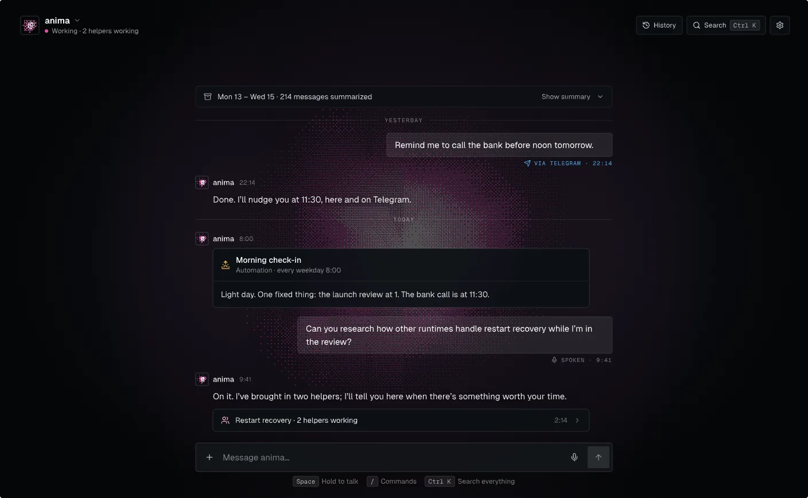
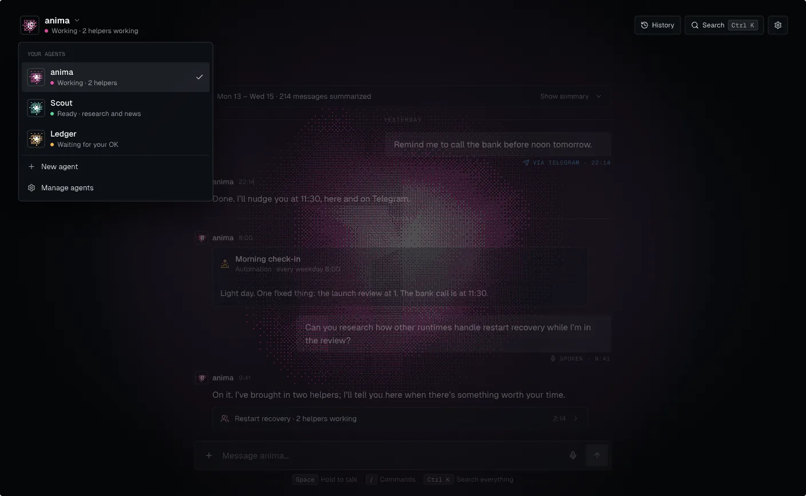
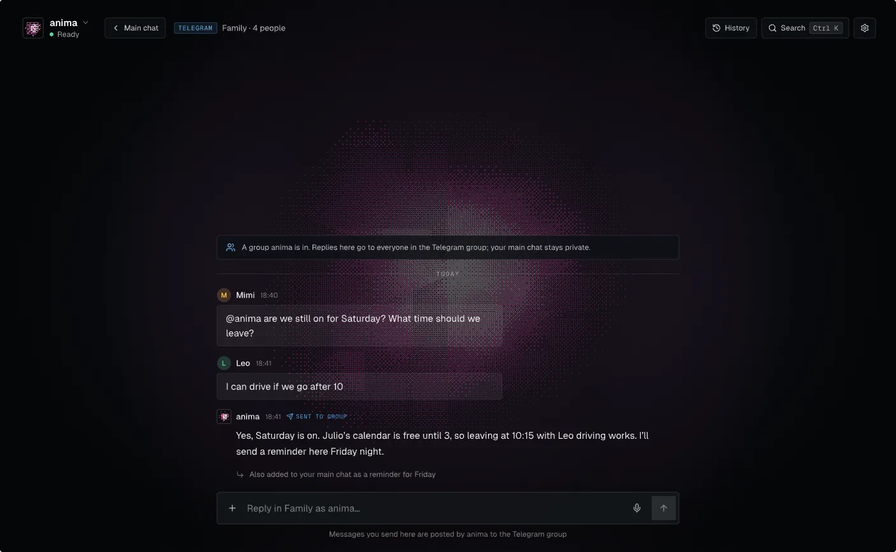
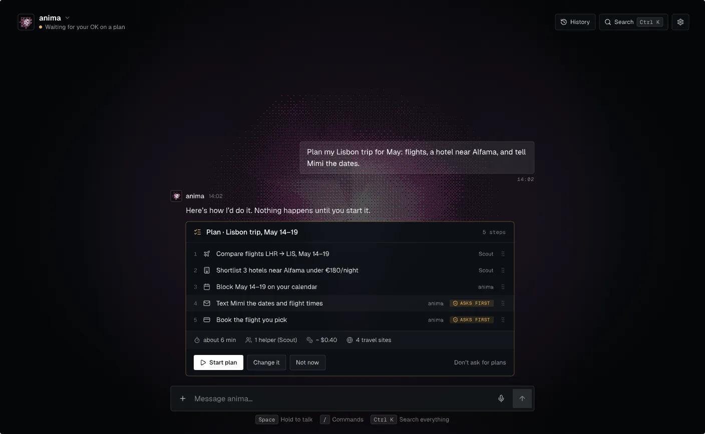
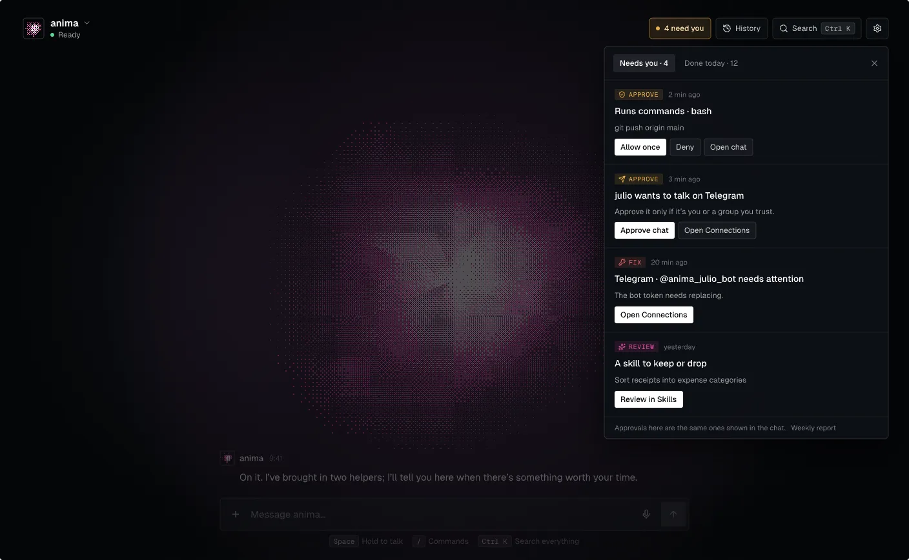
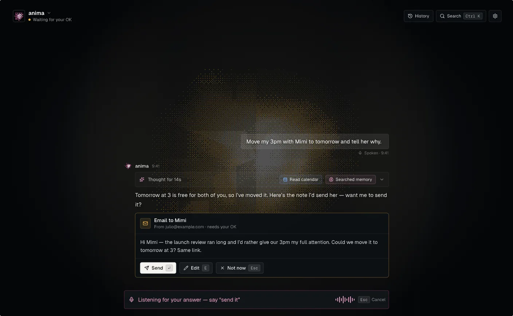
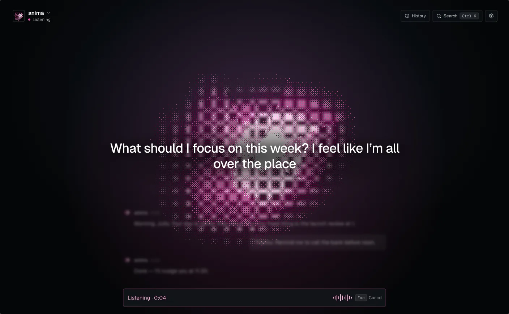
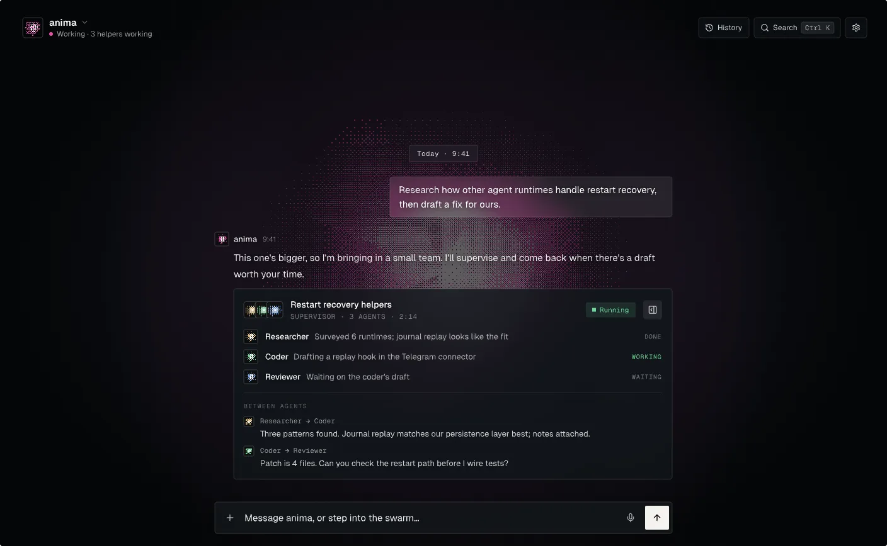
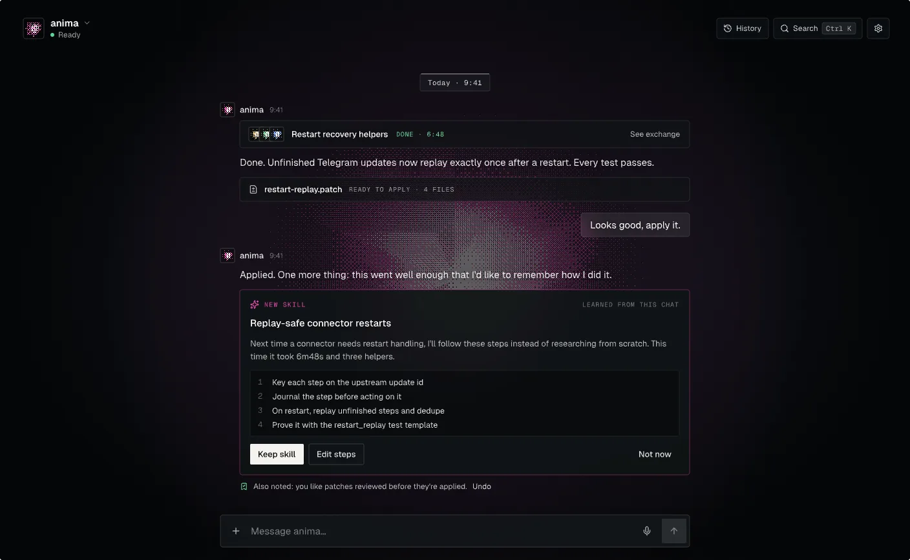

# animaOS-SWARM

**anima** is a personal AI that you own. It runs on your computer or your own server, and you talk to it in one ongoing chat, in the web console or on Telegram. It brings in helper agents for bigger jobs, shows you its plan and asks before it acts, and gets better at your work over time.

This repository is the whole stack: a Rust agent runtime, the daemon that hosts it, the TypeScript SDK, and the web console.



## What anima does

- **One main chat.** Each agent has one ongoing conversation with one memory, so "that thing from yesterday" means something. Your private Telegram chat joins it, and every message shows where it came from. Telegram groups and Discord channels get their own threads.
- **More than one agent.** Make agents for different parts of your life and switch between them from the name in the header. The header always shows who you're talking with and what it's doing.
- **Talk or type.** Dictate, have replies read aloud, or send recorded audio for transcription. Voice and text land in the same chat.
- **Shows you the plan first.** Before a bigger job that changes things, anima lays out its steps and waits. Start it, send back changes, or tell it to stop asking.
- **Asks before it acts.** Anything that runs commands, sends messages or changes files can go through approvals you control: once, for this chat, always, or denied.
- **One place for what needs you.** Approvals, plans, Telegram pairing requests, broken connections and skills to review all wait in one inbox, next to a list of everything it changed today.
- **Helpers for big jobs.** anima can delegate to helper agents, such as a researcher, a coder and a reviewer, supervise them, and bring back one result you can review.
- **Learns from your work.** It keeps memory of what matters and drafts reusable skills from tasks that went well. Nothing becomes a skill until you approve it.
- **A weekly report.** What it finished, what it changed, what it cost, what failed, and what it kept about you, from its own records.
- **Runs where you want.** On your machine by default, or as a single-owner service on a Linux VPS with Docker, HTTPS and sign-in.
- **Works with your stack.** Many model providers, Google Drive, Calendar and mail, reviewed MCP tools, community bundles, documents, web search and scoped browser work.

## A look at it

| | |
| --- | --- |
|  |  |
| **Your agents.** The header shows who you're talking with and what it's doing. Switch agents from its name. | **Chat apps.** Your private Telegram chat is part of the main chat. A group gets its own thread, and replies go back to the group. |
|  |  |
| **Plans.** For bigger jobs anima shows its steps first, marks the ones that will ask again, and waits for you. | **Needs you.** Everything waiting on you in one place, answered in a click. |
|  |  |
| **Approvals.** Before anything leaves your machine, anima asks. Answer with a button or by voice. | **Voice.** Hold Space and talk; your words appear over the orb, and the chat stays underneath. |
|  |  |
| **Helpers.** Bigger jobs go to a small team, shown right in the chat with what each one is doing. | **Learning.** When a task goes well, anima offers to keep how it did it as a skill. |

## Status

| Area | Today |
| --- | --- |
| Web console: main chat per agent, agent switcher, history, onboarding, Settings | Built |
| Rust daemon with persistence, restart recovery and streaming | Built |
| Telegram and Discord, embedded in the daemon; private Telegram chats join the main chat | Built |
| Memory, task reviews, owner-approved skills, approvals, automations | Built |
| Plans before bigger jobs (`propose_plan`), the Needs-you inbox, "Done today", the weekly report | Built |
| Helper agents (delegation) | Built |
| Voice: browser dictation, read aloud, recorded-audio transcription and selected-reply speech (the last two are server opt-ins) | Built |
| Reviewed MCP tools, community bundles, documents, web search, scoped browser work | Built, with the scope limits described in [docs/companion](docs/companion) |
| One-owner VPS deployment | Built; some acceptance checks are still manual ([guide](deploy/vps/README.md)) |
| Undo for actions the agent took | Coming next: "Done today" lists every change, but nothing can be rolled back from it yet |
| Wake word and hands-free voice | Coming next |

## Quick start

With Bun and Rust installed:

```bash
bun install --frozen-lockfile
bun x nx run @animaOS-SWARM/sdk:build
bun dev --host rust
```

Open [localhost:4200](http://localhost:4200), set up your companion and connect a model provider. Setup is a few short steps: model, introductions, access and voice.

- **Run it on a server:** the [VPS deployment guide](deploy/vps/README.md) covers HTTPS, owner authentication, credentials, backups and current limits.
- **Day-to-day setup:** [Anima daily-use setup](docs/companion/daily-use.md) covers identity files, memory, approvals, schedules and connectors.

## How the repo is organised

| Path | What lives there |
| --- | --- |
| `packages/core-rust` | The Rust runtime: `anima-core`, `anima-memory`, `anima-swarm`, `anima-schedule`, `anima-harness`, `anima-model-adapters`, `anima-document-content`. It has no HTTP framework and no host-specific code. |
| `hosts/rust-daemon` | `anima-daemon`, the runnable Axum host. It exposes HTTP and SSE, and embeds the Telegram and Discord connectors. `hosts/elixir-phoenix` and `hosts/python-service` are placeholders. |
| `packages/sdk` | The public TypeScript client for the daemon. |
| `packages/core-ts` | The shared TypeScript core used by the SDK, CLI, TUI and UI. Execution behaviour lives in Rust. |
| `packages/*` | Other libraries: `cli`, `tui`, `ui`, `memory`, `swarm`, `tools`, `mod-sdk`. |
| `apps/web` | The companion web console (React and Vite). |
| `apps/playground`, `apps/docs`, `apps/contributor-docs` | The playground and the two Astro documentation sites. |
| `apps/server` | The legacy local TypeScript server, kept during the restructuring. |
| `tools/workspace-dev` | The `bun dev` launcher, which picks the host and starts the browser apps. |
| `deploy/vps` | Docker Compose, Caddy and the daemon image for a one-owner server. |
| `design/` | The pen.dev design file and the orb shader. |

More detail: [Rust daemon architecture](docs/rust-daemon-architecture.md), [swarm architecture](docs/swarm-architecture.md), [package maturity](docs/package-maturity-scorecard.md).

## Design

The interface is designed in [pen.dev](https://pen.dev) before it is built. [`design/design.pen`](design/design.pen) holds every screen:
- the end-to-end journey and onboarding
- the main chat, its states (working, offline, errors, plans, receipts) and the agent switcher
- the Needs-you inbox and the weekly report
- chat moments, helpers, and every Settings page
- the components sheet, mascot explorations and the landing page

The orb is a shader, [`design/shaders/presence.glsl`](design/shaders/presence.glsl).

UI changes start in the design file and are built from it.

## Development

See [docs/testing.md](docs/testing.md) for focused validation commands and the [contributor playbook](apps/contributor-docs/src/content/docs/workflow/playbook.mdx) for a step-by-step bring-up.

```bash
bun run build              # build all packages
bun run test               # run all tests
bun run affected:test      # only what changed on this branch
bun run graph              # open the project graph

bun dev                    # daemon + web console + playground (same as bun dev --host rust)
bun run daemon             # the Rust daemon only
bun run web                # the web console only (daemon must be running)
```

Prefer Nx targets for focused work, for example `bun x nx run rust-daemon:test` or `bun x nx run-many -t typecheck,build,test -p @animaOS-SWARM/web`.

## CLI and SDK (advanced)

The CLI and terminal UI remain available for agency and SDK workflows. `create` runs locally; `launch`, `run` and `chat` talk to the daemon.

```bash
bun run build:cli-sdk
export OPENAI_API_KEY="sk-..."
bun run animaos create my-agency --provider openai --model gpt-4o-mini

bun run daemon                                   # in another terminal
cd my-agency
bun run animaos launch "Write a blog post about AI"     # TUI
bun run animaos launch --no-tui "your task"             # plain text, one task
bun run animaos launch --no-tui                         # plain-text prompt (/help, /health, exit)
```

Use the repo-local CLI while developing: Bun runs this workspace's `animaos` build. See [docs/SDK_USAGE.md](docs/SDK_USAGE.md) for the SDK.

### Model providers

| Provider | Accepted names | Key env vars | Base URL env var | Notes |
| --- | --- | --- | --- | --- |
| OpenAI | `openai` | `OPENAI_API_KEY`, `OPENAI_KEY`, `OPENAI_TOKEN` | `OPENAI_BASE_URL` | Native chat completions |
| Anthropic | `anthropic` | `ANTHROPIC_API_KEY`, `ANTHROPIC_KEY`, `ANTHROPIC_TOKEN`, `CLAUDE_API_KEY` | `ANTHROPIC_BASE_URL` | Native Messages API |
| Google Gemini | `google`, `gemini` | `GOOGLE_API_KEY`, `GOOGLE_KEY`, `GOOGLE_AI_KEY`, `GEMINI_API_KEY`, `GOOGLE_GENERATIVE_AI_API_KEY` | `GOOGLE_BASE_URL` | Native `generateContent` |
| Ollama | `ollama` | `OLLAMA_API_KEY` | `OLLAMA_BASE_URL` | Local; OpenAI-compatible |
| Groq | `groq` | `GROQ_API_KEY`, `GROQ_KEY`, `GROQ_TOKEN` | `GROQ_BASE_URL` | OpenAI-compatible |
| xAI | `xai`, `grok` | `XAI_API_KEY`, `XAI_KEY`, `GROK_API_KEY` | `XAI_BASE_URL` | OpenAI-compatible |
| OpenRouter | `openrouter` | `OPENROUTER_API_KEY`, `OPENROUTER_KEY`, `OPENROUTER_TOKEN` | `OPENROUTER_BASE_URL` | OpenAI-compatible |
| Mistral | `mistral` | `MISTRAL_API_KEY`, `MISTRAL_KEY`, `MISTRAL_TOKEN` | `MISTRAL_BASE_URL` | OpenAI-compatible |
| Together | `together` | `TOGETHER_API_KEY`, `TOGETHER_KEY`, `TOGETHER_TOKEN` | `TOGETHER_BASE_URL` | OpenAI-compatible |
| DeepSeek | `deepseek` | `DEEPSEEK_API_KEY` | `DEEPSEEK_BASE_URL` | OpenAI-compatible |
| Fireworks | `fireworks` | `FIREWORKS_API_KEY` | `FIREWORKS_BASE_URL` | OpenAI-compatible |
| Perplexity | `perplexity` | `PERPLEXITY_API_KEY` | `PERPLEXITY_BASE_URL` | OpenAI-compatible |

`--api-key` overrides the environment for one CLI call. For daemon-backed commands, credentials are forwarded per request, so changing keys doesn't need a daemon restart. In the web console, the ChatGPT subscription and server-side keys are set up during onboarding or later in Settings → Model.

## Tech stack

Rust (Axum, SQLite), Bun, TypeScript, React, Vite, Tailwind, Nx, Vitest, Playwright, and pen.dev for design.

## License

MIT

For task progress, background helpers, local Python and selected-file recovery,
see the [Rust autonomous runtime guide](hosts/rust-daemon/README.md#autonomous-runtime).
